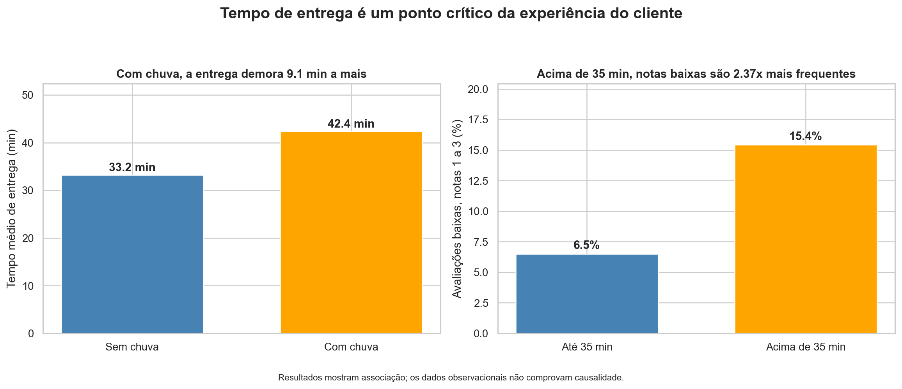

# Tempo de entrega é um ponto crítico da experiência do cliente: diagnóstico de 2024 do app de delivery

A análise mostra que chuva e entregas mais demoradas estão associadas a piora operacional e avaliações mais baixas; a prioridade para 2025 deve ser monitorar a faixa de 35–40 minutos, preparar a operação para chuva e medir o retorno real dos cupons.



_Painel esquerdo: tempo médio de entrega com e sem chuva; painel direito: percentual de avaliações de 1 a 3 por faixa de tempo. 8.058 pedidos, 2024._

### 1. Pergunta de negócio

A diretoria do app pediu um diagnóstico dos pedidos de 2024 para apoiar o planejamento de 2025. A análise investigou três frentes: **operação** (volume e tempo de entrega), **clientes** (ticket e avaliação) e **alavancas** (cupons e chuva). O foco foi identificar diferenças relevantes para o negócio sem confundir associação com causalidade.

**Perguntas que guiaram a análise:**

- Quando os pedidos acontecem e quanto tempo as entregas levam?
- Quais fatores estão associados a entregas mais demoradas?
- Como o tempo de entrega se relaciona com a avaliação dos clientes?
- Como cupons se relacionam com ticket, clientes novos e a campanha de julho?
- Cidade, tipo de cozinha e plataforma apresentam diferenças relevantes nos pedidos?

### 2. Dados

- **Fonte:** `delivery_pedidos.csv`, fornecida no módulo DS-PY-018 (dados simulados de um app de delivery).
- **Período e escopo:** 01/01/2024 a 31/12/2024; São Paulo, Rio de Janeiro e Belo Horizonte.
- **Tamanho:** 8.058 × 18 na base original → 8.058 × 18 na base limpa publicada. As colunas constantes `pais` e `moeda` foram removidas, e as flags de qualidade `tempo_invalido` e `distancia_invalida` foram incluídas. Nenhum pedido foi excluído.
- **Unidade de observação:** um pedido.

#### Dicionário da base limpa (`saidas/delivery_pedidos_limpo.csv`)

| Coluna               | Tipo     | Descrição                                      | % faltantes | Observação / tratamento                                                          |
| -------------------- | -------- | ---------------------------------------------- | ----------: | -------------------------------------------------------------------------------- |
| `pedido_id`          | int      | identificador do pedido                        |       0.00% | —                                                                                |
| `data_hora`          | datetime | data e hora do pedido                          |       0.00% | convertida de texto para datetime durante a limpeza                              |
| `cidade`             | texto    | cidade de entrega                              |       0.00% | variantes de grafia padronizadas para São Paulo, Rio de Janeiro e Belo Horizonte |
| `bairro`             | texto    | bairro de entrega                              |       0.00% | mantido como informado                                                           |
| `restaurante_id`     | texto    | identificador do restaurante                   |       0.00% | mantido como informado                                                           |
| `tipo_cozinha`       | texto    | tipo de cozinha do restaurante                 |       0.00% | mantido após inspeção das categorias                                             |
| `plataforma`         | texto    | plataforma do pedido                           |       0.00% | 153 faltantes substituídos por "Não informado"                                   |
| `forma_pagamento`    | texto    | forma de pagamento                             |       0.00% | grafias e abreviações padronizadas                                               |
| `cupom`              | bool     | indica se o pedido utilizou cupom              |       0.00% | convertida para booleano                                                         |
| `cliente_novo`       | bool     | indica se o pedido é de cliente novo           |       0.00% | mantida como booleana                                                            |
| `chuva`              | bool     | indica ocorrência de chuva                     |       0.00% | convertida para booleano                                                         |
| `distancia_km`       | float    | distância estimada do pedido em quilômetros    |       4.00% | 7 distâncias extremas invalidadas → NaN; faltantes originais preservados         |
| `tempo_entrega_min`  | float    | tempo entre pedido e entrega, em minutos       |       0.41% | 25 códigos 999 e 8 valores negativos → NaN                                       |
| `valor_pedido`       | float    | valor dos itens do pedido, sem taxa de entrega |       0.00% | 720 valores monetários em formato incompatível convertidos para numérico         |
| `taxa_entrega`       | float    | valor da taxa de entrega                       |       0.00% | mantida como numérica; frete grátis representado por zero                        |
| `avaliacao`          | float    | avaliação do pedido                            |      16.65% | 1.342 faltantes preservados como NaN                                             |
| `tempo_invalido`     | bool     | flag de qualidade do tempo de entrega          |       0.00% | True identifica os 33 tempos invalidados na limpeza                              |
| `distancia_invalida` | bool     | flag de qualidade da distância                 |       0.00% | True identifica as 7 distâncias invalidadas após investigação                    |

### 3. Como rodar

```bash
git clone https://github.com/Douglllasms/projeto-final-ds-py-018.git
cd projeto-final-ds-py-018
python -m venv .venv
# Windows: .venv\Scripts\activate
# Linux/macOS: source .venv/bin/activate
pip install -r requirements.txt
jupyter notebook projeto_final.ipynb
```

- O notebook lê o CSV original em `dados/delivery_pedidos.csv`.
- Execute **Kernel → Restart & Run All**.
- As bibliotecas principais são pandas, NumPy, Matplotlib, Seaborn e SciPy. As versões usadas estão no `requirements.txt`.

### 4. Estrutura do repositório

```text
.
├── README.md
├── requirements.txt
├── projeto_final.ipynb
├── autoavaliacao.md
├── dados/
│   └── delivery_pedidos.csv
└── saidas/
    ├── delivery_pedidos_limpo.csv
    └── figura_principal.png
```

### 5. Metodologia

- **Perguntas e hipóteses:** planejamento das perguntas de negócio e de seis hipóteses estatísticas antes dos testes.
- **Carga e inspeção:** identificação de tipos incorretos, categorias inconsistentes, valores ausentes e valores impossíveis.
- **Limpeza:** padronização de categorias e tipos, conversão monetária e preservação dos 8.058 pedidos sempre que possível.
- **Outliers:** 33 tempos inválidos e 7 distâncias extremas foram invalidados; pedidos grandes plausíveis foram mantidos.
- **Estatística descritiva:** medidas de centro, dispersão, percentis e assimetria para caracterizar as principais variáveis.
- **Sumarização e granularidade:** análises por cidade, cozinha, plataforma, pagamento, cupom e tempo para conectar pedido individual e padrões agregados.
- **Visualização:** gráficos com títulos-conclusão, unidades e padrão de cores consistente.
- **Correlação:** investigação de relações entre variáveis, com atenção explícita a confundidores e à diferença entre correlação e causalidade.
- **Testes de hipótese:** Welch, Mann-Whitney, Spearman, Kruskal-Wallis, ANOVA e qui-quadrado, com α = 5% e tamanhos de efeito.
- **Conclusões:** cinco achados, três recomendações mensuráveis e limitações da análise.

#### Decisões de limpeza

| Problema                      | Linhas afetadas | Decisão                             | Alternativa considerada                                |
| ----------------------------- | --------------: | ----------------------------------- | ------------------------------------------------------ |
| `tempo_entrega_min` negativo  |               8 | → `NaN` + flag `tempo_invalido`     | remover a linha                                        |
| `tempo_entrega_min = 999`     |              25 | → `NaN` + flag `tempo_invalido`     | remover a linha                                        |
| distâncias extremamente altas |               7 | → `NaN` + flag `distancia_invalida` | manter como entrega real ou remover a linha            |
| `plataforma` ausente          |             153 | → `Não informado`                   | remover os pedidos ou imputar uma plataforma existente |
| `avaliacao` ausente           |           1.342 | → manter `NaN`                      | imputar uma nota                                       |

### 6. Principais achados


_Painel esquerdo: tempo médio de entrega com e sem chuva; painel direito: percentual de avaliações de 1 a 3 por faixa de tempo. Base analisada: 8.058 pedidos de 2024._

1. **Chuva e tempo de entrega:** pedidos com chuva apresentaram tempo médio de **42,36 minutos**, contra **33,23 minutos** sem chuva, uma diferença de **9,13 minutos**. Na Tarefa 9.1, o tamanho de efeito foi grande (d de Cohen = 0,89), o que destaca a chuva como uma condição operacional relevante.

2. **Tempo de entrega e avaliação:** avaliações de 1 a 3 representaram **6,5%** das entregas de até 35 minutos e **15,4%** das entregas acima de 35 minutos, ficando aproximadamente **2,37 vezes mais frequentes** no segundo grupo. O resultado da Tarefa 9.3 liga desempenho operacional à experiência do cliente.

3. **Cupom e ticket:** o ticket mediano foi de **R$ 57,22** nos pedidos com cupom e **R$ 62,82** nos pedidos sem cupom, diferença de **R$ 5,60**. A Tarefa 9.2 mostra associação entre cupom e ticket típico menor, mas a base não possui o valor do desconto nem o custo da campanha, portanto não permite concluir se os cupons tiveram retorno financeiro positivo.

4. **Julho de cupons:** em julho, **45,62%** dos pedidos utilizaram cupom, contra aproximadamente **18,50%** nos demais meses, cerca de **2,5 vezes mais**. O comportamento observado nas Tarefas 6.7 e 7.8 coincide com a campanha “Julho de cupons”, mas os dados não permitem atribuir causalidade à campanha.

5. **Tipo de cozinha e ticket:** as medianas do valor dos pedidos variaram de aproximadamente **R$ 38,42 a R$ 107,97** entre os tipos de cozinha, com tamanho de efeito de aproximadamente **ε² = 0,41** no Kruskal-Wallis da Tarefa 9.4. O mix de cozinha é relevante para entender diferenças de ticket.

#### Hipóteses testadas (α = 5%)

| Hipótese                       | Teste principal         |       p-valor | Efeito                               | Decisão        | Em linguagem de negócio                                 |
| ------------------------------ | ----------------------- | ------------: | ------------------------------------ | -------------- | ------------------------------------------------------- |
| H1 chuva × tempo de entrega    | Welch unilateral        |       < 0,001 | +9,13 min; d = 0,89                  | Rejeita H0     | chuva está associada a entregas mais demoradas          |
| H2 cupom × ticket              | Mann-Whitney bilateral  |       < 0,001 | mediana −R$ 5,60                     | Rejeita H0     | pedidos com cupom têm ticket típico menor; não mede ROI |
| H3 tempo × avaliação           | Spearman + Mann-Whitney |       < 0,001 | ρ = −0,24; notas baixas 6,5% → 15,4% | Rejeita H0     | tempos maiores estão associados a avaliações piores     |
| H4 cozinha × ticket            | Kruskal-Wallis          |       < 0,001 | ε² ≈ 0,41                            | Rejeita H0     | o tipo de cozinha está fortemente associado ao ticket   |
| H5 cidade × forma de pagamento | Qui-quadrado            |         0,695 | V de Cramér = 0,015                  | Não rejeita H0 | não houve evidência relevante de associação             |
| H6 plataforma × ticket         | ANOVA + Kruskal-Wallis  | 0,712 / 0,659 | η² ≈ 0; ε² = 0                       | Não rejeita H0 | não houve diferença relevante de ticket por plataforma  |

### 7. Recomendações

|   # | Recomendação                                                                  | Achados que sustentam | Métrica para acompanhar                                                                       |
| --: | ----------------------------------------------------------------------------- | --------------------- | --------------------------------------------------------------------------------------------- |
|   1 | Preparar a operação para dias de chuva e priorizar pedidos próximos de 35 min | 1 e 2                 | % de entregas > 35 min em dias de chuva; tempo médio/mediano; % > 45 min; % notas 1–3         |
|   2 | Usar 35–40 min como zona de atenção e > 40 min como prioridade operacional    | 2                     | % > 35 min; pedidos > 40/45 min; avaliação média; % notas 1–3                                 |
|   3 | Medir desconto, custo, ticket líquido e retenção antes de ampliar campanhas   | 3 e 4                 | receita líquida por pedido; margem; desconto médio; clientes novos; recompra em 30/60/90 dias |

### 8. Limitações

1. Os dados são observacionais e não permitem concluir causalidade isolada.
2. A base não contém trânsito, quantidade de entregadores, capacidade dos restaurantes ou fila de pedidos.
3. A base não informa valor do desconto, custo da campanha ou regra de concessão dos cupons, portanto não permite calcular ROI.
4. Algumas análises usam apenas observações válidas porque existem ausências em avaliação, distância e tempo de entrega tratado.

### 9. Próximos passos

- Registrar variáveis operacionais como trânsito, entregadores disponíveis e carga dos restaurantes para separar melhor os fatores ligados ao atraso.
- Registrar valor do desconto, custo, campanha e regras de concessão para medir margem e ROI de cupons.
- Acompanhar recompra em 30, 60 e 90 dias para medir retenção de clientes atraídos por promoções.
- Monitorar continuamente os indicadores de tempo > 35 min, > 45 min e avaliações baixas, especialmente em dias de chuva.

### 10. Autores

| Nome                 | GitHub                                        | Principais contribuições                                                              |
| -------------------- | --------------------------------------------- | ------------------------------------------------------------------------------------- |
| Douglas Luiz Zaniolo | [Douglllasms](https://github.com/Douglllasms) | análise exploratória, limpeza, visualização, testes estatísticos, conclusões e README |

_Projeto final do módulo DS-PY-018 · Análise Exploratória de Dados · CAIXAVERSO FC5 · Analista de Dados I (turma #1735) · novembro/2026_
